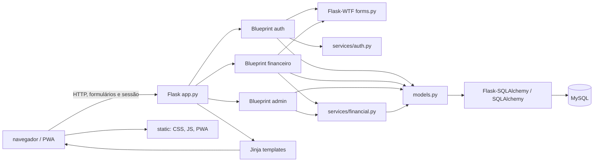
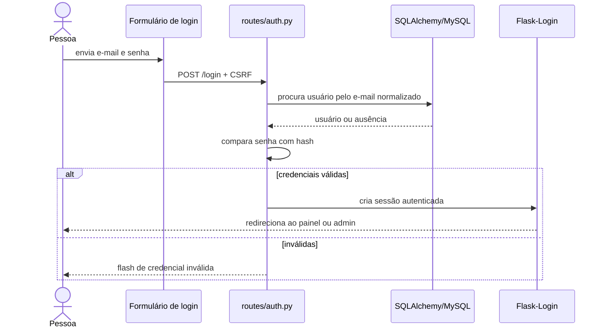
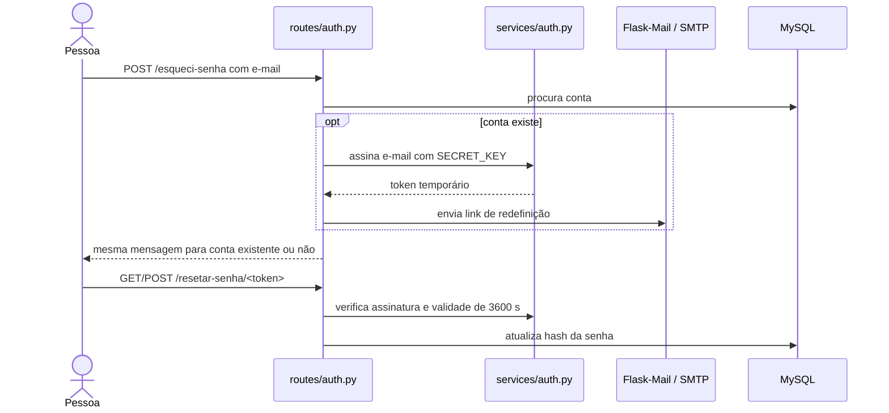

# Arquitetura e fluxos

## Estilo arquitetural

Aplicação web Flask renderizada no servidor, organizada por responsabilidades. As rotas coordenam o caso de uso; WTForms valida entrada; os modelos representam dados; serviços concentram cálculos reutilizados; SQLAlchemy persiste no MySQL. Jinja renderiza HTML e os assets estáticos atendem CSS, JavaScript, ícone, manifesto e service worker.

## Componentes

| Componente | Responsabilidade |
| --- | --- |
| `app.py` | Application factory, carregamento de extensões, rotas principais e comandos CLI |
| `extensions.py` | Instâncias compartilhadas de SQLAlchemy, Migrate, LoginManager, Mail e CSRF |
| `routes/auth.py` | Cadastro, login, logout e redefinição de senha |
| `routes/financeiro.py` | CRUD de movimentações, categorias, meta mensal, filtros, paginação e dicas |
| `routes/admin.py` | Controle de acesso administrativo, agregações e CSV |
| `forms.py` | Campos e validações de entrada |
| `models.py` | Mapeamento objeto-relacional e relações entre entidades |
| `services/financial.py` | Totais, perfil financeiro, histórico mensal e descrições |
| `services/auth.py` | Geração e validação de token temporário de recuperação |
| `migrations/` | Histórico de mudanças de schema com Alembic |
| `templates/` e `static/` | Interface do servidor e experiência PWA |

## Fluxo de autenticação

## Fluxo de movimentação

1. O navegador solicita `/movimentacoes/nova`; a rota configura opções de tipo e categorias visíveis.
2. A pessoa preenche formulário validado por WTForms e protegido por CSRF.
3. A rota cria ou altera `Movement`, recalcula o perfil com atualização forçada e confirma a transação.
4. A interface recebe flash e redireciona para o histórico.
5. Para excluir, o navegador abre um diálogo; a confirmação envia POST com token CSRF.

## Fluxo de recuperação de senha

## Rotas HTTP

| Caminho | Método | Proteção | Finalidade |
| --- | --- | --- | --- |
| `/` | GET | Pública | Redireciona para painel ou login |
| `/cadastro` | GET, POST | Pública | Criar conta |
| `/login` | GET, POST | Pública | Autenticar |
| `/logout` | POST | Sessão + CSRF | Encerrar sessão |
| `/esqueci-senha` | GET, POST | Pública + CSRF no POST | Solicitar link de recuperação |
| `/resetar-senha/<token>` | GET, POST | Token temporário + CSRF no POST | Alterar senha |
| `/painel` | GET | Login obrigatório | Resumo do usuário atual |
| `/movimentacoes` | GET | Login obrigatório | Histórico paginado e filtrado |
| `/movimentacoes/nova` | GET, POST | Login obrigatório | Criar movimentação |
| `/movimentacoes/<id>/editar` | GET, POST | Login + propriedade | Editar movimentação própria |
| `/movimentacoes/<id>/excluir` | POST | Login + propriedade + CSRF | Excluir movimentação própria |
| `/categorias/nova` | GET, POST | Login obrigatório | Criar categoria pessoal |
| `/meta-mensal` | GET, POST | Login obrigatório | Definir ou remover limite mensal |
| `/dicas` | GET | Login obrigatório | Conteúdo e sugestão contextual |
| `/admin/` | GET | Login + papel admin | Indicadores administrativos |
| `/admin/relatorio.csv` | GET | Login + papel admin | Exportar agregados |
| `/teste-banco` | GET | Sem login | Verificar conectividade com `SELECT 1` |
| `/service-worker.js` | GET | Pública | Entregar service worker com escopo raiz |

## Persistência e consistência

Operações de escrita usam a sessão SQLAlchemy e `commit()` ao concluir o caso de uso. Exclusões de usuário possuem cascata em movimentações, categorias pessoais e perfil; categorias globais permanecem sem proprietário. Alterações estruturais devem ser criadas como revisão Alembic, nunca como SQL manual de manutenção.

## PWA e cache

O manifesto declara nome, ícone, escopo e modo standalone. O service worker armazena CSS, JavaScript, ícone e manifesto. Rotas HTML, respostas autenticadas e dados financeiros não entram no cache; portanto, o app não oferece modo offline para operações.