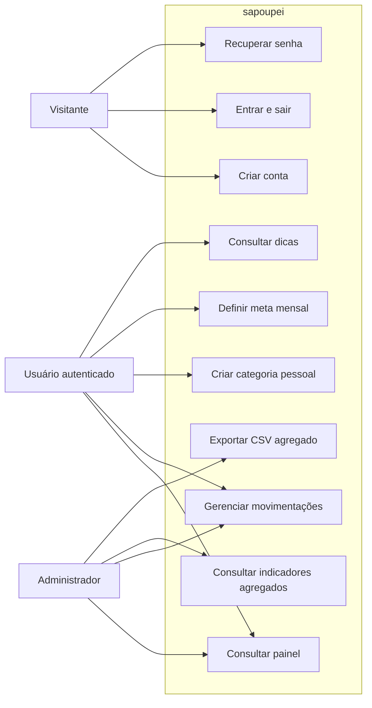
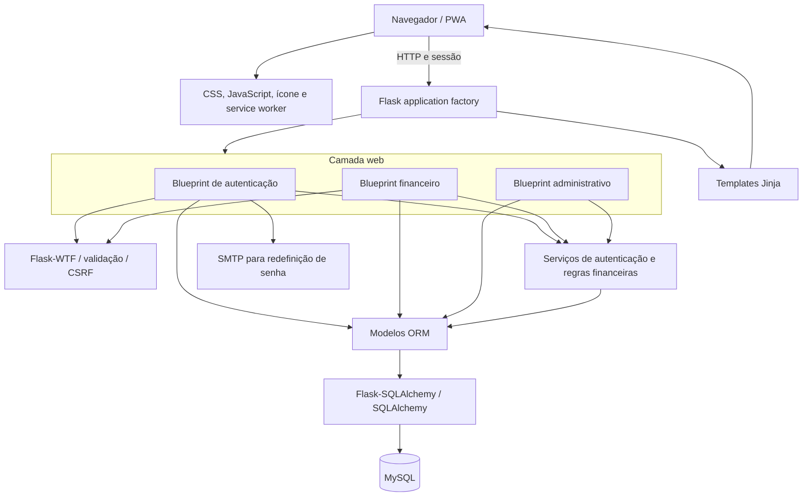
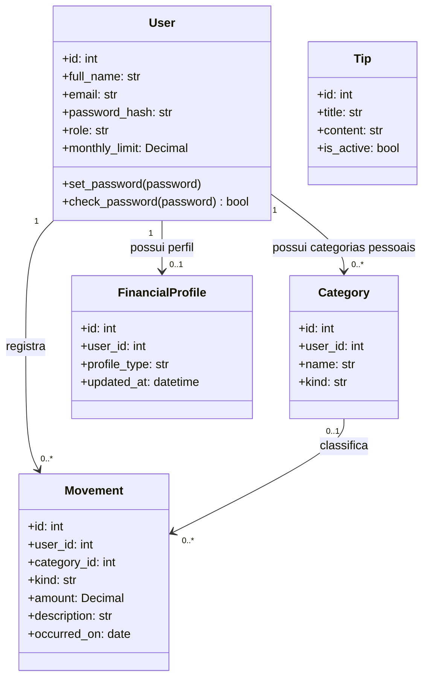
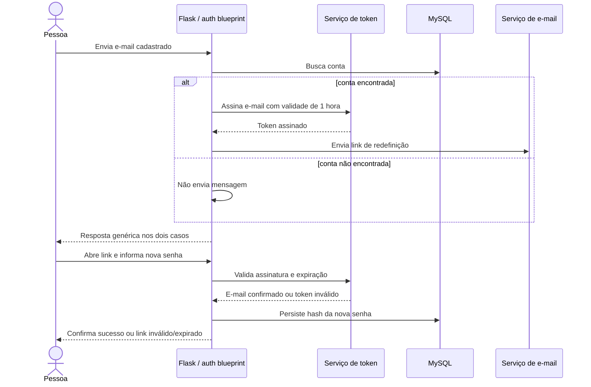
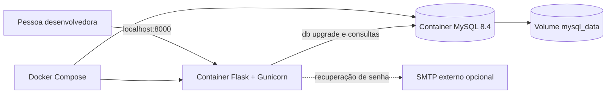

# Diagramas do sistema

Os diagramas abaixo estão em Mermaid. No VS Code, abra este arquivo e use **Markdown: Open Preview** (`Ctrl+Shift+V`) para visualizar os desenhos renderizados. Também podem ser copiados para ferramentas compatíveis com Mermaid.

## 1. Casos de uso



## 2. Arquitetura lógica



## 3. Modelo entidade-relacionamento

```mermaid
erDiagram
    USUARIOS ||--o{ MOVIMENTACOES : registra
    USUARIOS ||--o{ CATEGORIAS : possui
    USUARIOS ||--o| PERFIS_FINANCEIROS : possui
    CATEGORIAS o|--o{ MOVIMENTACOES : classifica

    USUARIOS {
        int id PK
        string full_name
        string email UK
        string password_hash
        string age_range
        string city
        decimal monthly_limit
        datetime consent_at
        string role
        datetime created_at
    }
    CATEGORIAS {
        int id PK
        int user_id FK "NULL para categoria global"
        string name
        string kind
    }
    MOVIMENTACOES {
        int id PK
        int user_id FK
        int category_id FK "opcional"
        string kind
        decimal amount
        string description
        date occurred_on
    }
    PERFIS_FINANCEIROS {
        int id PK
        int user_id FK_UK
        string profile_type
        datetime updated_at
    }
    DICAS {
        int id PK
        string title
        text content
        boolean is_active
    }
```

## 4. Diagrama de classes do domínio



## 5. Sequência de recuperação de senha



## 6. Implantação local



No modo local sem Docker, o Flask roda no ambiente Python e usa o banco definido pelas variáveis `DB_*`. Em ambos os modos, o envio SMTP só funciona quando `MAIL_*` está configurado.