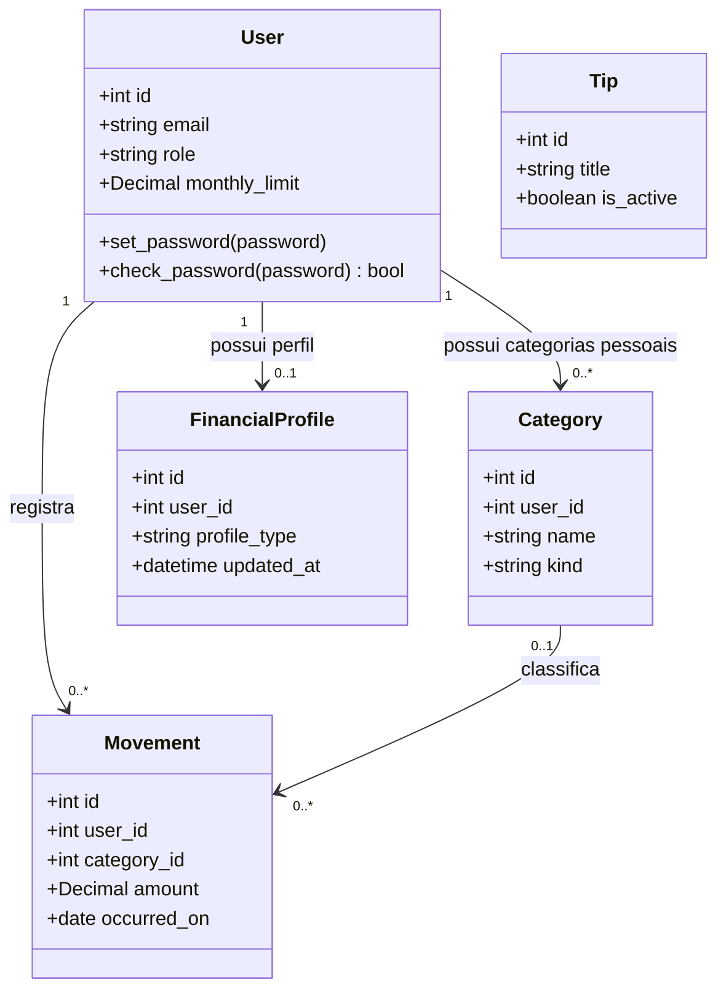

# Referência técnica

Este guia registra os símbolos públicos e helpers principais presentes no código atual. Os nomes de classes e funções são mantidos como no código para facilitar navegação no editor.

## Extensões

Em `extensions.py` são declaradas instâncias não vinculadas a um app específico, inicializadas pelo application factory:

| Símbolo | Tipo | Papel |
| --- | --- | --- |
| `db` | `SQLAlchemy` | Sessão, metadata e modelos ORM |
| `migrate` | `Migrate` | Integra Alembic ao CLI Flask |
| `login_manager` | `LoginManager` | Sessão e carregamento de usuário |
| `mail` | `Mail` | Envio SMTP |
| `csrf` | `CSRFProtect` | Proteção contra CSRF |

## Modelos ORM (`models.py`)

### `User`

Mapeia `usuarios` e herda `UserMixin`. Campos: `id`, `full_name`, `email`, `password_hash`, `age_range`, `city`, `monthly_limit`, `consent_at`, `role`, `created_at`. Relaciona-se a movimentações, categorias pessoais e perfil financeiro.

| Método | Contrato |
| --- | --- |
| `set_password(password: str) -> None` | Gera e armazena o hash da senha |
| `check_password(password: str) -> bool` | Compara uma senha informada ao hash armazenado |

### `Category`

Mapeia `categorias`; possui `id`, `user_id` anulável, `name` e `kind`. A propriedade `owner` relaciona a categoria à conta, quando pessoal. A restrição única é `uq_categoria_user_nome_tipo`.

### `Movement`

Mapeia `movimentacoes`; possui dono obrigatório, categoria opcional, tipo, valor, descrição e data. `user` aponta para a conta; `category` aponta para a categoria opcional.

### `Tip`

Mapeia `dicas`; possui título, conteúdo e flag `is_active`.

### `FinancialProfile`

Mapeia `perfis_financeiros`; relação um-para-um com `User`, tipo de perfil e instante da última atualização.

### `money_total(value: Decimal | None) -> Decimal`

Converte `None`/valor vazio em `Decimal("0.00")` para cálculos financeiros.

## Formulários (`forms.py`)

Todos herdam `FlaskForm`; os POSTs usam token CSRF. As validações são aplicadas no servidor.

| Formulário | Campos e validações principais |
| --- | --- |
| `RegistrationForm` | Nome até 120; e-mail válido até 255; faixa etária de lista fixa; cidade opcional até 100; senha mínima de 10; confirmação igual; consentimento obrigatório |
| `LoginForm` | E-mail, senha e opção “manter conectado” |
| `PasswordResetRequestForm` | E-mail obrigatório e válido |
| `PasswordResetForm` | Nova senha mínima de 10 e confirmação igual |
| `LogoutForm` | Token CSRF do POST de logout |
| `MovementForm` | Tipo; descrição até 160; valor mínimo 0,01 com duas casas; data; categoria |
| `DeleteForm` | Formulário CSRF para exclusão |
| `CategoryForm` | Nome entre 2 e 60; tipo |
| `MonthlyLimitForm` | Limite opcional entre 0,01 e 9.999.999.999,99; vazio remove a meta |

## Serviços financeiros (`services/financial.py`)

| Função | Contrato e regra |
| --- | --- |
| `profile_start_date(today: date | None = None) -> date` | Data de corte de 30 dias atrás |
| `get_totals(user_id: int, since: date | None = None) -> tuple[Decimal, Decimal]` | Retorna receita e despesa; aceita início de período opcional; usa agregação condicional em uma consulta |
| `classify_finances(income: Decimal, expenses: Decimal) -> str` | Classifica como Em formação, Gastador, Poupador, Equilibrado ou Organizado |
| `refresh_financial_profile(user_id: int, force: bool = False) -> FinancialProfile` | Busca perfil; recalcula no máximo uma vez por dia, salvo `force=True`; mutações de movimentação forçam atualização |
| `get_month_history(user_id: int, today: date | None = None) -> dict` | Monta totais de receitas/despesas dos últimos seis meses para os gráficos |
| `profile_description(profile_type: str) -> str` | Retorna o texto educativo associado ao perfil |

## Serviço de autenticação (`services/auth.py`)

| Função | Contrato e regra |
| --- | --- |
| `gerar_token_recuperacao(email: str) -> str` | Assina o e-mail com `SECRET_KEY` e salt `recuperacao-senha` |
| `verificar_token_recuperacao(token: str, expiracao: int = 3600) -> str \| None` | Valida assinatura/idade; retorna e-mail ou `None` |

## Application factory e CLI (`app.py`)

| Símbolo | Contrato |
| --- | --- |
| `load_user(user_id: str) -> User \| None` | Callback do Flask-Login; converte ID e recupera usuário |
| `create_app(config_class: type[Config] = Config) -> Flask` | Cria app, carrega config, inicializa extensões, registra blueprints e rotas |
| `service_worker()` | Serve o worker no caminho raiz, define escopo `/` e `Cache-Control: no-cache` |
| `inject_logout_form()` | Injeta `LogoutForm` nos templates base |
| `inicio()` | Redireciona usuário autenticado ao painel; visitante ao login |
| `painel()` | Calcula totais, limite mensal, perfil, últimas movimentações e série de seis meses |
| `teste_banco()` | Executa `SELECT 1`; retorna 503 se ocorrer erro SQLAlchemy |
| CLI `init-db` | Insere categorias e dicas padrão ausentes; não cria tabelas |
| CLI `promote-admin <email>` | Promove conta existente para papel `admin` |

## Rotas de autenticação (`routes/auth.py`)

| Função | Caminho/métodos | Comportamento |
| --- | --- | --- |
| `cadastro()` | `/cadastro`, GET/POST | Valida dados, impede e-mail duplicado, cria perfil e hash de senha, inicia sessão |
| `login()` | `/login`, GET/POST | Normaliza e-mail, verifica hash e direciona por papel |
| `esqueci_senha()` | `/esqueci-senha`, GET/POST | Procura conta e tenta enviar link; resposta externa é genérica |
| `resetar_senha(token)` | `/resetar-senha/<token>`, GET/POST | Valida token e grava hash da nova senha |
| `logout()` | `/logout`, POST | Encerra sessão autenticada e redireciona ao login |

## Rotas financeiras (`routes/financeiro.py`)

| Função | Caminho/métodos | Comportamento |
| --- | --- | --- |
| `_set_form_choices(form, default_kind="despesa")` | Helper | Monta escolhas de tipo/categorias globais e da pessoa autenticada |
| `_get_movement(movement_id)` | Helper | Recupera somente movimentação do usuário atual; caso contrário responde 404 |
| `lista_movimentacoes()` | `/movimentacoes`, GET | Filtra tipo e pagina 20 itens |
| `nova_movimentacao()` | `/movimentacoes/nova`, GET/POST | Define tipo/categorias, valida, cria registro e força recálculo do perfil |
| `editar_movimentacao(movement_id)` | `/movimentacoes/<id>/editar`, GET/POST | Autoriza por propriedade, atualiza registro e perfil |
| `nova_categoria()` | `/categorias/nova`, GET/POST | Verifica duplicidade global/pessoal e cria categoria pessoal |
| `excluir_movimentacao(movement_id)` | `/movimentacoes/<id>/excluir`, POST | Valida CSRF, exclui registro próprio e atualiza perfil |
| `dicas()` | `/dicas`, GET | Carrega dicas ativas, totais, perfil e recomendação contextual |
| `meta_mensal()` | `/meta-mensal`, GET/POST | Exibe ou salva/remove limite mensal |
| `_apply_form(movement, form)` | Helper | Copia campos validados do formulário para o modelo |

## Rotas administrativas (`routes/admin.py`)

| Função | Responsabilidade |
| --- | --- |
| `admin_required(view_function)` | Decorator: exige login e papel `admin`, caso contrário aborta 403 |
| `_month_starts(today)` | Calcula o primeiro dia dos seis meses usados nos gráficos |
| `_build_report()` | Agrega totais, médias, faixas etárias, categorias, perfis e meses; exclui admins |
| `dashboard()` | Renderiza painel administrativo a partir de `_build_report()` |
| `export_report()` | Gera CSV agregado com BOM UTF-8 para compatibilidade com planilhas |